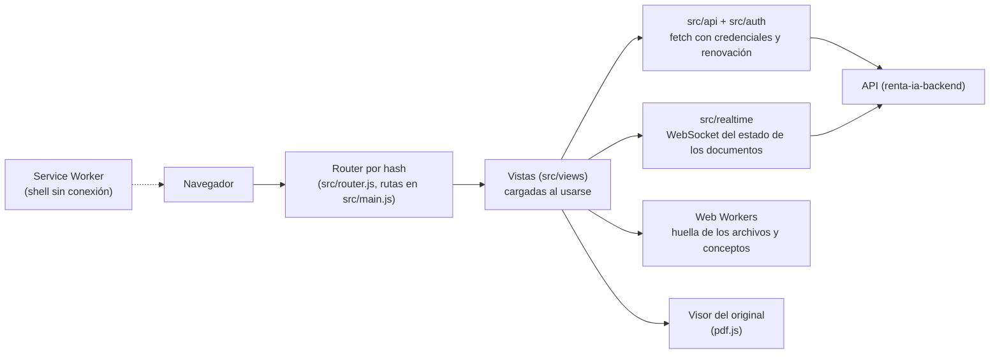

# renta-ia-frontend: la aplicación web de Renta IA

**Producción:** <https://renta.jonarproyectos.com>

Este repositorio es la parte visible de **Renta IA**, la gestión documental contable con IA: clientes,
documentos, revisión de conceptos con el original al lado, alertas, resumen, asistente de IA, cuenta y
administración. La **guía completa para evaluar el proyecto** (acceso, roles y la prueba de cada
función paso a paso) está en el README principal, en
[renta-ia-backend](https://github.com/Jonar519/renta-ia-backend#readme). Aquí se explica lo propio del
frontend.

## Contenido

1. [Qué es](#1-qué-es)
2. [Cómo funciona](#2-cómo-funciona)
3. [Tecnologías](#3-tecnologías)
4. [Qué se necesita](#4-qué-se-necesita)
5. [Acceso y roles](#5-acceso-y-roles)
6. [Guía de pruebas](#6-guía-de-pruebas)
7. [Pruebas automatizadas](#7-pruebas-automatizadas)
8. [Limitaciones y decisiones de diseño](#8-limitaciones-y-decisiones-de-diseño)
9. [Solución de problemas](#9-solución-de-problemas)
10. [Estructura del repositorio](#10-estructura-del-repositorio)
11. [Glosario](#11-glosario)

## 1. Qué es

Una aplicación de una sola página (SPA) en **JavaScript sin framework**, con Vite, que habla con la API
de [renta-ia-backend](https://github.com/Jonar519/renta-ia-backend). Incluye:

- **Clientes** del contador, con densidad de tabla configurable.
- **Detalle del cliente**: documentos (subida con huella para evitar duplicados y estado en tiempo
  real), conceptos tributarios y su revisión, visor del original con vista dividida, alertas, resumen
  y asistente de IA.
- **Cuenta**: Mi perfil (datos, foto, correo, contraseña, mis datos) y Seguridad (verificación en dos
  pasos y sesiones activas).
- **Administración**: usuarios e invitaciones, reasignación de clientes y rendimiento web.

## 2. Cómo funciona

Archivos estáticos servidos por Vercel. Los datos llegan de la API (`VITE_API_URL`, otro origen del
mismo sitio) con `fetch` y credenciales, y el estado de los documentos por WebSocket. Un **router por
hash** elige la pantalla y carga su código solo cuando hace falta:

| Ruta                                    | Pantalla                                          | Quién                          |
| --------------------------------------- | ------------------------------------------------- | ------------------------------ |
| `#/login`                               | Inicio de sesión                                  | Cualquiera                     |
| `#/recuperar` · `#/restablecer/<token>` | Pedir y usar el enlace de recuperación            | Cualquiera (con el enlace)     |
| `#/invitacion/<token>`                  | Activar la cuenta invitada                        | Con el enlace del correo       |
| `#/confirmar-correo/<token>`            | Confirmar un cambio de correo                     | Con el enlace del correo       |
| `#/`                                    | Clientes (o el expediente, para el contribuyente) | Con sesión                     |
| `#/clients/<id>`                        | Detalle del cliente                               | Con sesión y acceso al cliente |
| `#/profile` · `#/seguridad`             | Mi perfil · Seguridad                             | Con sesión                     |
| `#/admin/users` · `#/performance`       | Usuarios e invitaciones · Rendimiento             | Administrador                  |



Puntos clave (detalle en [docs/referencia-tecnica.md](docs/referencia-tecnica.md)):

- **Sesión:** el token de acceso vive solo en memoria; al recargar se renueva con una cookie httpOnly.
  En el almacenamiento local queda solo una pista (id, nombre y rol) que no sirve para llamar a la API.
- **Permisos:** la interfaz oculta lo que tu rol no puede hacer; quien decide es la API.
- **Duplicados:** un Web Worker calcula la huella SHA-256 del archivo antes de subirlo.
- **Rendimiento:** presupuesto de tamaño del build y métricas reales (Web Vitals) enviadas a la API.

## 3. Tecnologías

Rangos declarados en el `package.json`:

| Tecnología                                              | Versión                               | Para qué se usa                                                      | Por qué se eligió                                                       |
| ------------------------------------------------------- | ------------------------------------- | -------------------------------------------------------------------- | ----------------------------------------------------------------------- |
| **JavaScript** (módulos ES), HTML y CSS con tokens      | —                                     | Toda la app, sin framework                                           | El curso evalúa DOM, eventos y asincronía directamente.                 |
| **Vite**                                                | ^7.3.7                                | Desarrollo y build                                                   | Build rápido con división del código por ruta.                          |
| **pdf.js** (`pdfjs-dist`)                               | 6.4.299                               | Visor del documento original                                         | Muestra el PDF en la página, sin plugins.                               |
| **web-vitals**                                          | ^6.2.2                                | Métricas reales de rendimiento                                       | Alimenta la pantalla **Rendimiento** del administrador.                 |
| **@fontsource** (Inter, Source Serif 4, JetBrains Mono) | ^5.3.0                                | Fuentes autoalojadas                                                 | Sin pedir nada a terceros (lo exige la CSP).                            |
| **Web Workers** · **Service Worker** · **WebSocket**    | APIs del navegador                    | Huella y conceptos en segundo plano; shell sin conexión; tiempo real | Sin bloquear la interfaz y sin recargar.                                |
| **Vitest** + **jsdom** · **Playwright** + **axe**       | ^4.1.12 · ^29.1.1 · ^1.63.0 · ^4.13.0 | Pruebas unitarias; E2E y accesibilidad                               | E2E contra el sistema completo, vigilando la CSP en cada página.        |
| **ESLint** · **Prettier**                               | ^10.11.0 · ^3.9.9                     | Reglas y formato                                                     | La CI los exige.                                                        |
| **Vercel** · **GitHub Actions** · **gitleaks**          | —                                     | Hosting estático con cabeceras; CI y búsqueda de secretos            | Despliegue desde `main`; configuración en [`vercel.json`](vercel.json). |

## 4. Qué se necesita

- **Para evaluarlo en producción:** solo un navegador actualizado (Chrome, Edge o Firefox). Ver
  [Qué necesita el profesor](https://github.com/Jonar519/renta-ia-backend#4-qué-necesita-el-profesor).
- **Para correrlo en local:** Node.js 20 o superior y la API en `http://localhost:4000`
  ([opción local](https://github.com/Jonar519/renta-ia-backend#b-opción-local-opcional)). En `cmd.exe`:

```bat
cd renta-ia-frontend
npm install
npm run dev
```

Esperado: `Local: http://localhost:5173/`. La app usa por defecto la API en `http://localhost:4000`; para
otra, define `VITE_API_URL` (solo el origen), por ejemplo:

```ini
VITE_API_URL=http://localhost:4000
```

Para probar el Service Worker y la CSP del build: `npm run build` y `npm run preview` (puerto 4173; la
API debe tener `http://localhost:4173` en `CORS_ORIGIN`). Archivos de prueba sintéticos:
`node scripts\demo-files.mjs <carpeta>`.

## 5. Acceso y roles

Las cuentas se crean solo por invitación; el administrador usa verificación en dos pasos obligatoria.
Roles (contador, asistente, contribuyente y administrador) y qué hacer si algo falla:
[Acceso y roles](https://github.com/Jonar519/renta-ia-backend#5-acceso-y-roles).

## 6. Guía de pruebas

La guía función por función está en el README principal:
[Guía de pruebas](https://github.com/Jonar519/renta-ia-backend#6-guía-de-pruebas-función-por-función).
Qué pantallas de este repositorio cubre cada bloque:

| Bloque de la guía                     | Pantallas                                                                                        |
| ------------------------------------- | ------------------------------------------------------------------------------------------------ |
| A. Entrar                             | `#/login`, `#/seguridad` (activación de la verificación del admin)                               |
| B. Clientes y documentos              | `#/`, `#/clients/<id>` (pestaña Documentos, visor y vista dividida)                              |
| C. Alertas, resumen y asistente de IA | `#/clients/<id>` (pestañas Alertas, Resumen y Asistente IA)                                      |
| D. Roles y aislamiento                | `#/` del contribuyente, guardas de `#/admin/users`                                               |
| E. Administración                     | `#/admin/users`, `#/performance`, `#/invitacion/<token>`                                         |
| F. Tu cuenta                          | `#/profile`, `#/seguridad`, `#/recuperar`, `#/restablecer/<token>`, `#/confirmar-correo/<token>` |
| G. Robustez y seguridad               | Service Worker, almacenamiento del navegador, WebSocket                                          |

## 7. Pruebas automatizadas

| Comando            | Qué cubre                                                                                                                                                                                                                                    | Resultado esperado                               |
| ------------------ | -------------------------------------------------------------------------------------------------------------------------------------------------------------------------------------------------------------------------------------------- | ------------------------------------------------ |
| `npm test`         | Sesión, router y guardas, clientes, documentos, visor, revisión de conceptos, estados de carga y error, Service Worker, accesibilidad                                                                                                        | `Tests 259 passed (259)` en 30 archivos.         |
| `npm run lint`     | ESLint y Prettier                                                                                                                                                                                                                            | Sin errores.                                     |
| `npm run build`    | Build de producción con el presupuesto de tamaño (falla si se supera)                                                                                                                                                                        | Termina sin errores.                             |
| `npm run test:e2e` | Playwright + axe contra el sistema completo con IA simulada: flujo crítico, login, MFA, invitaciones, recuperación, perfil, foto, sesiones, mis datos, densidad, guardas, revisión, visor, vista dividida, reasignación, estados, tema y CSP | Todos en verde ([e2e/README.md](e2e/README.md)). |

La CI corre todo esto en cada `push`, más `npm audit` y gitleaks.

## 8. Limitaciones y decisiones de diseño

- **Sin framework y sin selector de tema:** a propósito; el tema sigue al sistema operativo.
- **El visor del original y la vista dividida son solo para el contador y el asistente;** el
  contribuyente y el administrador ven **Descargar**.
- **Algunas acciones de administración no tienen pantalla** (restablecer la verificación de una cuenta,
  editar o borrar un cliente, la auditoría): se hacen por la API.
- **`VITE_API_URL` se fija al construir:** también arma el `connect-src` de la CSP, así que cambiarla
  exige volver a construir.

## 9. Solución de problemas

| Síntoma                                     | Qué hacer                                                                                                      |
| ------------------------------------------- | -------------------------------------------------------------------------------------------------------------- |
| "Hay una versión nueva de Renta IA."        | Pulsa **Recargar**.                                                                                            |
| El estado de los documentos no se actualiza | La conexión de tiempo real se cayó o la red bloquea WebSockets; recarga la página.                             |
| Local: errores de CORS                      | El origen de la app debe estar en `CORS_ORIGIN` del backend (`http://localhost:5173`; para el build, `:4173`). |
| Local: `npm run build` falla por tamaño     | Se superó el presupuesto de `scripts/check-bundle.mjs`: revisa qué dependencia creció.                         |
| El visor no muestra el PDF                  | "El PDF está dañado o no se puede leer. Descárgalo para revisarlo."                                            |

Más síntomas del proyecto completo:
[Solución de problemas](https://github.com/Jonar519/renta-ia-backend#9-solución-de-problemas).

## 10. Estructura del repositorio

```
renta-ia-frontend/
├── index.html · public/        # documento base y archivos estáticos
├── src/
│   ├── main.js · router.js     # arranque, tabla de rutas y router por hash con guardas
│   ├── auth/ · api/            # sesión (token en memoria, renovación) y cliente de la API
│   ├── views/                  # login, clientes, detalle del cliente (clientDetail/), perfil, seguridad, admin
│   ├── components/ · state/    # piezas reutilizables y estado compartido
│   ├── realtime/               # WebSocket
│   ├── workers/                # huella de los archivos y conceptos (Web Workers)
│   ├── offline/ · sw/          # conectividad y Service Worker
│   ├── metrics/                # Web Vitals
│   ├── styles/ · utils/
├── tests/ · e2e/               # Vitest y Playwright
├── scripts/                    # presupuesto de tamaño, archivos de prueba…
├── perf/ · lighthouserc.json   # mediciones de rendimiento
├── docs/                       # referencia técnica, diseño, caché, seguridad, rendimiento
├── vite.config.js · vercel.json
└── package.json
```

## 11. Glosario

| Término                   | Qué significa aquí                                                                  |
| ------------------------- | ----------------------------------------------------------------------------------- |
| **SPA**                   | Aplicación de una sola página: carga una vez y cambia de pantalla sin recargar.     |
| **Router por hash**       | Elige la pantalla según lo que va después de `#` en la dirección.                   |
| **CSP**                   | Cabecera que limita de dónde carga scripts la página y a qué servidores se conecta. |
| **Web Vitals**            | Métricas de la experiencia real (carga, interacción y estabilidad visual).          |
| **Presupuesto de tamaño** | Tamaño máximo del código descargado; el build falla si se supera.                   |

El glosario completo está en el
[README principal](https://github.com/Jonar519/renta-ia-backend#11-glosario).
